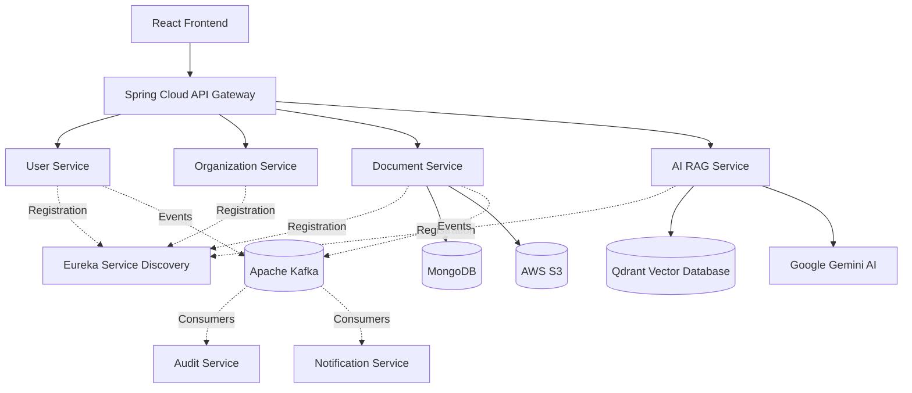

# AI-Knowledge-system
# 🚀 AI Startup Knowledge System

### An AI-powered organizational knowledge platform built with Java, Spring Boot Microservices, Apache Kafka, and Retrieval-Augmented Generation (RAG).

The **AI Startup Knowledge System** is a microservices-based platform designed to help startup teams organize their documents, manage organizational access, and retrieve useful information through an AI-powered knowledge assistant.

The platform combines secure authentication, organization-scoped access control, document storage, event-driven communication, vector search, and generative AI to turn organizational documents into searchable knowledge.

---

## ✨ Key Features

- **Microservices Architecture:** Separate services for authentication, organization management, documents, auditing, notifications, and AI-powered knowledge retrieval.
- **JWT Authentication:** Token-based authentication shared across services.
- **Role-Based Access Control (RBAC):** Supports `ADMIN`, `CEO`, `MANAGER`, and `EMPLOYEE` roles.
- **Invitation-Based Registration:** Administrators can invite users, with registration controlled by invitation tokens.
- **Organization-Scoped Knowledge:** Associates users, documents, and retrieved knowledge with an organization.
- **Document Management:** Upload documents to AWS S3 and store document metadata in MongoDB.
- **AI Knowledge Assistant:** Ask natural-language questions about information contained in organizational knowledge.
- **Retrieval-Augmented Generation (RAG):** Retrieves relevant document chunks from Qdrant before generating an answer with Google Gemini.
- **Semantic Search:** Uses text embeddings and vector similarity search to retrieve relevant context.
- **Event-Driven Architecture:** Uses Apache Kafka for asynchronous communication between services where configured.
- **Service Discovery:** Uses Netflix Eureka for service registration and discovery.
- **Centralized API Routing:** Uses Spring Cloud Gateway as the entry point for client requests.

## 🏗️ System Architecture



*The diagram illustrates the intended system architecture. Individual event flows and service integrations depend on the current implementation and configuration.*

## 🧠 How the RAG Pipeline Works

The AI RAG Service is designed to answer questions using relevant organizational knowledge rather than relying only on a language model's general knowledge.

1. **Document storage:** Documents are uploaded through the Document Service, with files stored in AWS S3 and metadata stored in MongoDB.
2. **Text extraction and chunking:** Document text is prepared and divided into smaller, overlapping chunks for retrieval.
3. **Embedding generation:** Text is converted into numerical vector embeddings.
4. **Vector indexing:** Knowledge chunks and their metadata are stored in Qdrant.
5. **Question submission:** An authenticated user asks a question through the AI endpoint.
6. **Semantic retrieval:** The RAG Service searches Qdrant for relevant chunks, filtered by organization.
7. **Context construction:** Retrieved chunks are assembled with their source metadata.
8. **AI response generation:** Google Gemini generates an answer using the retrieved context.

The current AI service returns a fallback response when no relevant knowledge is retrieved. Its prompt also instructs the model not to invent information outside the supplied context.

## 🧩 Microservices Overview

| Service | Responsibility |
|---|---|
| **API Gateway** | Centralized API entry point and JWT validation |
| **User Service** | Authentication, registration, roles, invitations, and user management |
| **Organization Service** | Organization creation and management |
| **Document Service** | Document metadata, file uploads, and AWS S3 integration |
| **AI RAG Service** | Embeddings, semantic retrieval, and AI-generated answers |
| **Audit Service** | Audit events and activity tracking |
| **Notification Service** | Notification processing |
| **Eureka Server** | Service registration and discovery |
| **Additional supporting services** | Other platform capabilities as implemented in the repository |

## 🛠️ Technology Stack

### Backend
- Java 21
- Spring Boot
- Spring Security
- Spring Cloud Gateway
- Spring Cloud Netflix Eureka
- Spring Cloud OpenFeign
- Spring Data MongoDB
- REST APIs
- JSON Web Tokens (JWT)

### Artificial Intelligence
- Spring AI
- Google Gemini
- Text Embeddings
- Retrieval-Augmented Generation (RAG)
- Qdrant Vector Database
- Semantic Similarity Search

### Data and Messaging
- MongoDB
- MySQL, where configured for relational services
- AWS S3
- Apache Kafka

### Frontend and Development
- React
- Maven
- Git and GitHub
- Postman
- Docker and Kubernetes for containerization and deployment practice

## 🔐 Authentication and Authorization

The platform uses JWT claims to carry authenticated user information across services.

The token includes:

- `sub`: user email
- `userId`: authenticated user's identifier
- `role`: assigned application role
- `organizationId`: associated organization identifier

The supported application roles are:

| Role | Intended responsibility |
|---|---|
| `ADMIN` | Manage organization configuration and invite users |
| `CEO` | Access organization knowledge and leadership workflows |
| `MANAGER` | Access organization knowledge and management workflows |
| `EMPLOYEE` | Access permitted organizational knowledge |

The User Service is the source of truth for user identity, roles, invitations, and organization association. Sensitive authorization decisions must be enforced by backend services, not merely by the frontend.

## 🔌 API Examples

### 1. User Login

```http
POST /auth/login
Content-Type: application/json
```

```json
{
  "email": "admin@abcstartup.com",
  "password": "YOUR_PASSWORD"
}
```

Use the JWT returned by the login endpoint in subsequent authenticated requests.

### 2. Upload a Document

```http
POST /api/documents/upload
Authorization: Bearer YOUR_JWT_TOKEN
Content-Type: multipart/form-data
```

Form-data fields:

| Field | Type | Example |
|---|---|---|
| `file` | File | `architecture.pdf` |
| `documentType` | Text | `TECHNICAL_DOCUMENT` |
| `description` | Text | `System architecture documentation` |

The service derives the user and organization identifiers from the authenticated principal.

### 3. Ask the AI Knowledge Assistant

```http
POST /api/ai/ask
Authorization: Bearer YOUR_JWT_TOKEN
Content-Type: application/json
```

Request body:

```json
{
  "question": "What does our system architecture document describe?"
}
```

Example response structure:

```json
{
  "answer": "The retrieved organizational knowledge describes ...",
  "question": "What does our system architecture document describe?",
  "organizationId": 2,
  "sources": []
}
```

The example response is illustrative. Actual answers depend on indexed documents, retrieval results, and the AI provider response.

### 4. Retrieve Organization Documents

```http
GET /api/documents/organization/2
Authorization: Bearer YOUR_JWT_TOKEN
```

### 5. Retrieve a Document by ID

```http
GET /api/documents/{documentId}
Authorization: Bearer YOUR_JWT_TOKEN
```

> **Note:** Verify that each endpoint is routed through the API Gateway and that authentication and organization-level authorization are correctly enforced before exposing it in a production deployment.

## ⚙️ Local Development Setup

### Prerequisites

Install or configure:

- JDK 21
- Maven or the included Maven Wrapper
- Git
- MongoDB
- MySQL, if required by the relational services
- Qdrant
- Apache Kafka, if running the event-driven services
- An AWS account and an S3 bucket
- A Google Gemini API key
- A configured JWT signing secret

Eureka and the required microservices must also be running for service discovery and inter-service communication.

### 1. Clone the Repository

```bash
git clone https://github.com/Tanushri-Patil-27/AI-StartUp-Knowledge-System.git
cd AI-StartUp-Knowledge-System
```

### 2. Configure Environment Variables

Set the required values in your local terminal. For Windows PowerShell:

```powershell
$env:JWT_SECRET="YOUR_SHARED_LONG_JWT_SECRET"
$env:GEMINI_API_KEY="YOUR_GEMINI_API_KEY"
$env:AWS_REGION="ap-south-1"
$env:AWS_S3_BUCKET_NAME="YOUR_S3_BUCKET_NAME"
$env:MONGODB_URI="YOUR_MONGODB_CONNECTION_STRING"
```

Configure AWS credentials securely using an appropriate AWS credentials provider or the AWS CLI.

Additional variables may be required by individual services, including database URLs, database usernames and passwords, Kafka settings, and initial administrator configuration.

**Security:** Never commit `.env` files, API keys, cloud credentials, passwords, or production JWT secrets to GitHub.

### 3. Configure Qdrant

Configure the RAG service's `application.properties` with the appropriate Qdrant connection settings:

```properties
spring.ai.vectorstore.qdrant.host=localhost
spring.ai.vectorstore.qdrant.port=6334
spring.ai.vectorstore.qdrant.collection-name=startup_knowledge
spring.ai.vectorstore.qdrant.use-tls=false
spring.ai.vectorstore.qdrant.initialize-schema=true
```

Ensure that Qdrant is running and that the configured gRPC port is reachable.

### 4. Start the Services

Start the infrastructure dependencies first, followed by Eureka, the required backend services, and the API Gateway.

For a service that uses the Maven Wrapper, navigate to its directory and run:

```powershell
.\mvnw.cmd spring-boot:run
```

Repeat this for the required services in the repository. Each service must have its own valid configuration and port.

### 5. Test Using Postman

1. Log in through the User Service or the configured Gateway route.
2. Copy the JWT from the login response.
3. Upload a document using the Document Service.
4. Ensure the document's text is processed and indexed into Qdrant.
5. Submit a question to `/api/ai/ask`.
6. Verify that the answer is based on relevant retrieved knowledge.

An uploaded file will not automatically become searchable knowledge unless the document extraction, chunking, embedding, and indexing workflow has been connected and executed.

## 🗂️ Project Structure

The repository is organized into independently developed services. The following is a representative overview; exact module and package names may differ:

```text
AI-StartUp-Knowledge-System/
├── APIGateway/
├── user/
├── OrganizationService/
├── document/
├── AuditService/
├── Notification/
├── rag/
├── server/
└── README.md
```

Each service contains its own application code, configuration, dependencies, and responsibilities.

## 🚀 Future Enhancements

- Complete and automate document ingestion from uploads through text extraction and vector indexing.
- Add support for additional document formats and OCR.
- Return source-document citations and retrieval scores in AI responses.
- Add document-level permissions and more granular access policies.
- Implement reliable event delivery, retries, and dead-letter handling for Kafka consumers.
- Add automated integration tests for authentication and cross-service authorization.
- Containerize the full stack and implement a reproducible deployment pipeline.
- Add centralized logging, metrics, tracing, and production monitoring.
- Improve RAG evaluation, prompt-injection resistance, and retrieval quality.

## 🎯 Project Goals

This project explores how modern backend and AI technologies can work together to build an organizational knowledge platform. It brings together distributed service design, secure authentication, cloud object storage, event-driven processing, vector databases, and generative AI.

**Core engineering focus:** Java backend development, Spring Boot microservices, API security, distributed systems, cloud integration, and Retrieval-Augmented Generation.

## 👩‍💻 Author

**Tanushri Patil , Monal Patil**

B.Tech Computer Engineering | Java Backend Development | Spring Boot Microservices | Cloud & DevOps | AI Engineering

- GitHub: [Tanushri-Patil-27](https://github.com/Tanushri-Patil-27)
-GitHub: [Monal-Patil](https://github.com/MonalPatil467)


- Project Repository: [AI-StartUp-Knowledge-System](https://github.com/Tanushri-Patil-27/AI-StartUp-Knowledge-System)

---

⭐ If you find this project interesting, feel free to explore the repository and follow its development.
